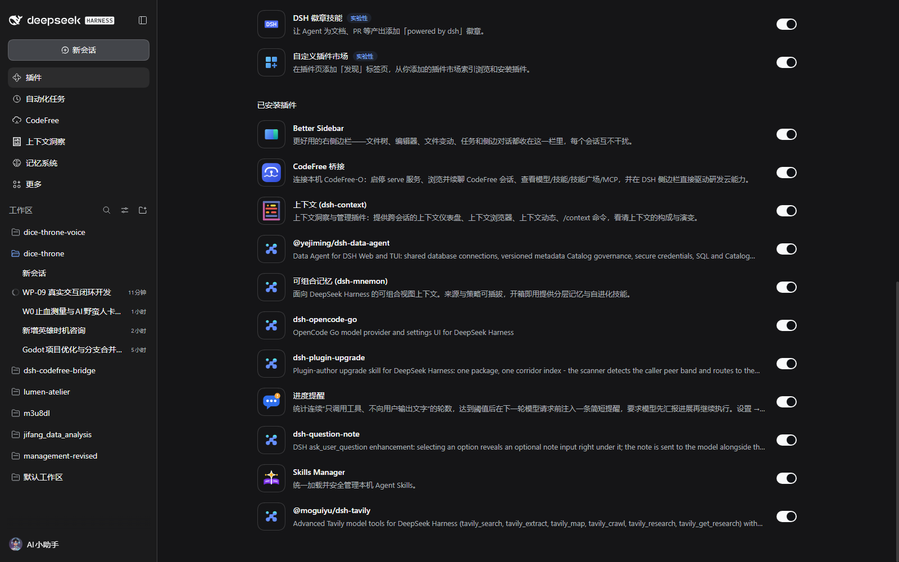

# dsh-progress-nudge

一个 DeepSeek Harness（dsh）插件：当模型连续多轮只发起工具调用、不向用户输出任何文字时，
在**下一次模型请求之前**注入一条简短提醒，要求它先汇报进展再继续执行；一旦模型输出文字，计数器立刻归零。

面向的现状痛点：DeepSeek V4.1 Flash 在 `reasoningEffort: max` 下容易陷入「思考 → 调工具 → 再思考 → 再调工具」的长循环，
界面上只有一串工具卡片，用户无法判断模型是在正常推进、卡住了，还是方向跑偏了。

插件同时提供一个 **设置 → 过程汇报** 页面，用来调整提醒间隔、提醒文案、语言、以及启用「智能体团队」时只提醒 Lead 还是提醒所有智能体。

## 界面预览

插件安装后出现在「插件」页的已安装列表（图标 + 本地化标题 + 描述 + 启用开关）：



---

## 1. 它具体做了什么

### 1.1 每个会话一个计数器

插件为每个**存活的 Agent 会话**维护两个数字（内存态，不落盘）：

| 字段 | 含义 |
| --- | --- |
| `streak` | 连续「只有工具调用、没有助手文本」的轮数 |
| `remindedAt` | 上一次提醒发生时的 `streak` 值，用于控制重复提醒节奏 |

计数只从**已提交的会话日志**推导，不轮询 `agent/status`，也不自己缓存事件流。

### 1.2 判定一轮是否「对用户沉默」

每收到一条 `assistant/message`（即一个模型 step 完成）时，检查这条助手消息的 `content` 块：

- 含**非空白 `text` 块** → 说明用户看到了文字 → `streak` 清零；
- 只有 `tool-call` 块（可能还带 `reasoning` 块）→ `streak += 1`；
- 两者都没有（例如空消息）→ 不计数，保持原值。

`reasoning`（思考）块被**故意忽略**：用户看不见它，把它算作「已汇报」会让提醒永远不触发，这正是插件要抓的场景。

另外两种情况直接跳过：

- `interrupted: true` 的助手消息（用户点停止、流被中断）不算一轮，避免误判；
- `includeSubagents` 关闭时（默认），`session.header.origin === 'subagent'` 的子代理会话不被计数。

### 1.3 达到阈值后注入提醒（`agent/pre-step`）

`streak` 达到 `threshold`（默认 **10**）时，提醒在**下一个 step 的边界**写入：

1. 插件注册了一个 `agent/pre-step` 瀑布监听器；
2. 它先 `await next()`，完整保留其它插件/内核给出的决策（包括 `reject`）；
3. 若决策是 `enter` 且该 Agent 的 `streak` 到期，则把一条 `source.kind = "progress-nudge"`
   的 user 消息**前置**到 `decision.messages` 里返回；
4. 内核随后照常把 `decision.messages` 逐条以 `user/message` 事件写进会话日志，再组装本次请求。

```
agent/pre-step 瀑布 → 决策 messages 里多一条提醒
                   → 内核 append 成 user/message（可回放、用户可见）
                   → 组装进紧接着的那一次模型请求
```

因此提醒**必然出现在下一次模型请求里**，不需要打断当前工具执行，也不会被丢掉；同时它是一条真实会话事件，
用户能在对话流里看到（渲染为 `progress-nudge` 注入行），事后也能从日志复盘「第几轮提醒过」。

> **必须避开的坑**：不要在 `session/event` 监听器里同步调用 `agent.inject()`。
> 内核的 `Session.commit()` 在派发 `session/event` 观察者时，自身的追加仍处于「进行中」
> （`appending = true`）；此时任何再入追加（`agent.inject()` → `inbox.splice()` →
> `session.append("agent/inbox/spliced")`）都会被拒绝并抛出
> `session append cannot reenter while another append is being published`。
> 该异常被逐监听器吞掉，只留下一条 warn 日志——插件看起来是 active 的，却始终不产生任何注入。
> 把写入放到 step 边界（`agent/pre-step`）就完全绕开这个重入限制。

### 1.4 重复节奏与清零

- 达到阈值提醒一次；模型继续沉默时，**再积累满 `threshold` 轮**才提醒第二次（10 → 20 → 30 …），
  不会每轮刷屏；把 `repeat` 设为 `false` 则每段沉默只提醒一次。
- 任何一条含文字的助手消息都会把 `streak` 和 `remindedAt` 一起清掉。
- 每次 `turn/start`（新的用户回合）也会重置计数，避免上一回合的数字跨回合误伤。
- `session/disposed`（会话离开内存）时删除该会话的状态，`Map` 不会随会话数量无限增长。

### 1.5 子代理与「智能体团队」

- **子代理**（subagent / workflow 子会话）：产出是交给父代理回收的结果，不是给用户看的进度。
  默认不提醒（`includeSubagents: false`），避免它把 token 花在面向用户的措辞上。
- **智能体团队**（Agent Teams）：团队成员是独立的根会话，`includeSubagents` 区分不了它们。
  插件改用 `ctx.agentTeams.tryMembership(agent)` 判定角色：`role === "lead"` 的是 Lead 与不属于任何团队的独立智能体，
  `role === "teammate"` 的才是团队成员。`teamScope` 决定提醒范围：
  - `lead`（默认）：只提醒 Lead 与独立智能体——用户真正在看的那个会话；
  - `all`：团队成员也会收到提醒。
- 未启用智能体团队时，`teamScope` 不产生影响。

---

## 2. 设置页：设置 → 过程汇报

插件在 dsh 的 **Settings** 里注册一个独立页面（`settings.section` 槽位），标题随语言变化：
英文 `Progress nudge`、简体 `过程汇报`、繁體 `過程回報`。

页面字段：

| 界面字段 | 配置键 | 类型 | 默认值 | 说明 |
| --- | --- | --- | --- | --- |
| 提醒间隔阈值 | `threshold` | 整数 ≥ 1 | `10` | 连续多少轮沉默后提醒一次 |
| 提醒文案 | `text` | 字符串 | 空 | 用 `{n}` 表示当前连续沉默轮数；留空时使用所选语言的内置文案（输入框以占位提示展示） |
| 语言 | `language` | `en` / `zh-CN` / `zh-TW` | `zh-CN` | 同时决定内置提醒文案与设置页自身文案 |
| 模型继续沉默时重复提醒 | `repeat` | 布尔 | `true` | 每再积累一个阈值轮数再次提醒 |
| 同时提醒子代理 | `includeSubagents` | 布尔 | `false` | 是否也提醒 subagent 会话 |
| 智能体团队范围 | `teamScope` | `lead` / `all` | `lead` | 启用智能体团队时，只提醒 Lead 还是提醒所有成员 |

保存路径：页面向 Host 的 `remote.settings.describe()` 读取当前解析值，修改后调用
`remote.settings.update(ns, patch, revision)`，由内核写进 profile 的 `cordis.patch.yml` 覆盖行并热重载插件，
所以**保存后立即生效**，且升级插件不会丢配置。页面带 revision 校验：并发改动会提示冲突而不是静默覆盖。

内置文案（三种语言）：

```
【进度提醒 · 来自 Harness 的自动提醒，不是用户的新指令】
你已连续 {n} 轮只发起工具调用、没有向用户输出任何文字，用户看不到你的执行情况。
请先用一两句话简短汇报：① 已经完成了什么；② 当前结果或关键发现；③ 下一步准备做什么。
汇报之后再继续调用工具执行任务。
```

英文与繁体中文版本在 `index.js` 的 `DEFAULT_TEXTS` 中维护，设置页用同一份内容作为占位提示。

也可以不打开界面，直接在 profile 的 `cordis.patch.yml` 写顶层覆盖：

```yaml
- id: progress-nudge
  name: dsh-progress-nudge
  config:
    threshold: 10
    repeat: true
    includeSubagents: false
    teamScope: lead
    language: zh-CN
```

---

## 3. 安装、验证与卸载

安装（任选其一）：

- 在 dsh 里用插件管理器安装这个**本地目录**（`install_bundle`，target 写 `file:<本目录绝对路径>`）；
- 命令行：`dsh plugin --profile <profile> add file:<本目录绝对路径>`。

> 路径写法提醒：Windows 上如果工作区（如 `D:`）与 profile（`C:`）不在同一个盘，
> 普通绝对路径或 `link:` 会被包管理器记成跨盘相对链接，装完解析不到这个包
> （报 `cannot resolve profile bundle ...`）。用 `file:` 前缀可以避免：它会把包内容**复制**进 profile，
> 代价是之后修改源码需要重新安装一次。

新增 bundle 通常会通过 HMR 直接生效；如果没有出现新的插件行或设置页，重启 dsh 后再看。

验证清单：

1. 插件管理页出现「进度提醒 / Progress Nudge」行，带本包 `icon.svg` 图标；
2. **设置 → 过程汇报**出现独立页面，六个字段可读写，保存后提示「已保存」；
3. 让某个会话连续 10 轮只调工具、不输出文字，第 11 次模型请求前对话里应出现一条 `progress-nudge` 注入消息；
4. 模型下一次回复文字后，计数器清零；再连续沉默 10 轮会再次提醒（`repeat: false` 时不会）；
5. 启用智能体团队后，`teamScope: lead` 时团队成员不触发，`all` 时触发。

### 实测记录（2026-11-03，dsh 0.2.1-rc.5 / profile `desktop`，v0.1.1 阈值 3）

- `include:progress-nudge` 为 `enabled: true`、`fiberPhase: "active"`；
- 会话日志中先后出现两条注入（`seq 856`、`seq 879`），均在连续 3 轮无文本之后；
  模型回复文字后计数清零，第二次触发文案仍是「连续 3 轮」而不是 6；
- 每条注入都紧跟着一次带 `text` 块的 `assistant/message`，说明模型确实先汇报再继续执行。

v0.2.0 的阈值默认值改为 10，并新增设置页与智能体团队范围；验证方式见上面的清单。

卸载：插件管理器里移除该 bundle，或 `dsh plugin remove dsh-progress-nudge`。

---

## 4. 已知边界

- **计数不持久化**：进程重启后从 0 开始。它只影响「重启后第一次提醒出现的时机」，不影响正确性；会话日志仍是唯一事实来源。
- **历史替换不重算**：压缩（compaction）等操作替换会话表面时，插件不会回放重算，而是等下一次 `assistant/message` 自然修正。
- **只观察、不干预工具执行**：插件不修改工具调用、不改模型配置、不阻断 step；最坏情况只是多一条提醒消息。
- **插入位置**：提醒在下一个 `agent/pre-step` 决策里写入，和该 step 原本要认领的消息一起进入同一个请求。
- **不打断 reject**：如果其它插件在 `agent/pre-step` 里拒绝了该 step，插件原样返回该拒绝，不追加提醒、不清零。
- **设置页依赖浏览器端 warm 服务**：页面通过 `remote.settings` 读写配置；Host 未挂载 settings/config-editor 时页面会显示不可用提示。

---

## 5. 设计取舍（为什么不是别的方式）

| 备选方案 | 结论 | 原因 |
| --- | --- | --- |
| 在 `session/event` 里调用 `agent.inject()` | 未采用（实测失败） | `Session.commit()` 派发观察者时仍在追加中（`appending = true`），再入 `session.append` 会被拒绝并抛出 `session append cannot reenter while another append is being published`；异常被逐监听器吞掉，插件 active 但零注入 |
| `ctx.systemPrompt.context()` 注册动态上下文 | 未采用 | 只要 `streak` 未清零，提醒会**每个请求都出现**；每次出现/消失都会改写请求前缀（prompt cache 抖动），而且看不出「第几轮提醒过」这条可见痕迹 |
| `agent.followup()` 唤醒空闲 Agent | 未采用 | 需要纠正的场景发生在循环**正在运行**时；`followup` 目标是 `next-turn`，不是本回合内的下一次请求 |
| `tools/post-execute` + `additionalContexts` | 未采用 | 那条通道适合「某一次工具结果触发的提醒」（内置 `repeat-tool-reminder` 就这样做），而本插件判断的是**缺少助手文本**，这个事实只有在 step 边界才成立 |
| `sessionProjections` 单元 | 未采用 | projection 的 `apply` 必须是纯同步函数，提醒是副作用；状态也不需要暴露给其它插件 |
| 自建设置页自有存储 | 未采用 | 使用内核的 `settings` 命名空间可以直接复用 profile 覆盖行、revision 冲突检测与热重载，配置也随插件升级保留 |

`agent/pre-step` 是内核在每次模型请求前必经的瀑布扩展点：先 `next()` 再合并，既保留其它插件的决策，
又能让内核按正常路径把提醒落成 `user/message`，天然满足「下一次请求可见、可回放、失败不影响模型步进」。

---

## 6. 文件说明

| 文件 | 作用 |
| --- | --- |
| `index.js` | Host 半：配置 schema、事件折叠、`agent/pre-step` 注入、智能体团队/子代理过滤 |
| `client.js` | 浏览器半：设置 → 过程汇报 页面（React，自注册 ModuleLoader bundle，主题 token 样式） |
| `cordis.patch.yml` | Bundle 层，插入 `progress-nudge` 行并给默认配置 |
| `locale/en.json`、`locale/zh.json` | 插件管理页显示用的标题与描述 |
| `icon.svg` | 插件图标（原创图形） |
| `test/smoke.mjs` | 离线自测：配置读取、阈值、清零、重复节奏、团队范围、reject 透传等 |
| `README.md` / `LICENSE` | 本文档与 MIT 许可证 |

---

## 7. 开发自测

```bat
node test/smoke.mjs
```

覆盖内容：volatile 配置包装读取、三语言内置文案、分类判定（空白 text / reasoning / 多块混合）、
默认阈值 10、提醒文案与 `{n}` 替换、文本回复清零、重复节奏（10→20）、`repeat: false` 只提醒一次、
新回合 `turn/start` 重置、被中断消息不计、子代理默认跳过与开启、Agent Teams `lead`/`all` 两种范围、
`agent/pre-step` 返回 `reject` 时原样透传、无状态时不提醒、会话销毁后状态清理。

注意：`index.js` 在运行时从 Harness 安装处解析 `@deepseek-ai/dsh-llm` 与 `@deepseek-ai/schemastery`
（profile 解析层负责）。裸跑自测时需要让这两个包可解析，例如在插件目录里建一个指向某个 dsh 安装
`node_modules` 的临时链接，或 `pnpm add -D @deepseek-ai/dsh-llm @deepseek-ai/schemastery` 后运行。

---

## 8. 发布信息

- GitHub：<https://github.com/buaaflyaway/dsh-progress-nudge>
- 许可证：MIT
- 最低 dsh：`0.2.0-rc.2`（`engines.dsh` 限制在 `0.3.0` 之前）
